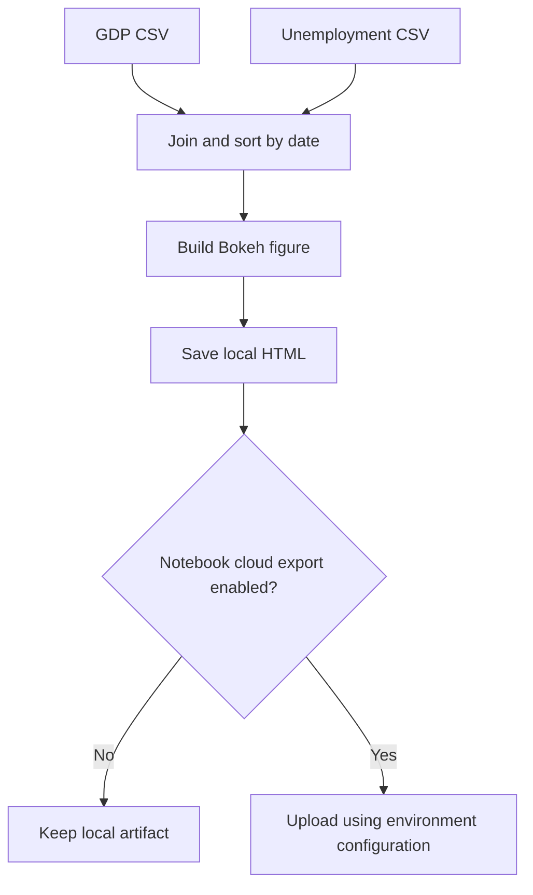

# US Economic Indicators: pandas and Bokeh: project walkthrough

[Overview](../README.md) · [Code reference](CODE_REFERENCE.md) · [Development guide](DEVELOPMENT.md)

## Three ways to explore

Read [Panda.ipynb](../Panda.ipynb) for introductory DataFrame/CSV/Excel/indexing exercises. Read [Jupyter.ipynb](../Jupyter.ipynb) for the economic-indicator workflow and original course prompts. Use [dashboard.py](../dashboard.py) when you want the chart-building path without a notebook session.

The notebooks retain their course context. They are not presented as an independently commissioned economic analysis or a source of current economic values.

## Repository map

| Path | Responsibility |
| --- | --- |
| [Panda.ipynb](../Panda.ipynb) | Reading albums data and selecting/slicing DataFrame rows and columns |
| [Jupyter.ipynb](../Jupyter.ipynb) | Reading GDP/unemployment data, filtering observations, plotting, and optional export |
| [dashboard.py](../dashboard.py) | Reusable plotting function and command-line CSV workflow |
| [requirements.txt](../requirements.txt) | Notebook, Excel, visualization, and optional cloud-client dependencies |
| [tests/test_dashboard.py](../tests/test_dashboard.py) | Local synthetic-data and notebook validation |

## Input and output contracts

| Object | Required fields or meaning |
| --- | --- |
| GDP DataFrame | `date`, `change-current` |
| Unemployment DataFrame | `date`, `unemployment` |
| Aligned DataFrame | Inner join on `date`, with one-to-one key validation, sorted by date |
| Bokeh figure | GDP percentage change and unemployment percentage drawn as separate labelled lines |
| HTML output | The filename passed to `--output`; no upload happens in the CLI |

`build_dashboard` selects the needed columns and joins the two files by date. This avoids comparing one year's GDP value with another year's unemployment value merely because the rows happen to occupy the same position. Duplicate dates fail the one-to-one merge check. A join with no matching dates raises an explicit error. Other malformed schemas or nonnumeric columns still need to be checked by the caller; the script is not a general data-quality framework.

`make_dashboard` accepts the already aligned series, checks their lengths, creates a figure, labels its two lines, and saves the HTML. It returns the figure, which lets tests inspect plotted data. Bokeh's standard HTML output may reference browser-side resources; this is not a promised self-contained offline export.

## Data and optional export flow

## Follow an alignment example

Suppose the GDP file lists years 2001 then 2000, while unemployment lists 2000 then 2001. `build_dashboard` joins by the date key and sorts the result to 2000 then 2001. The test checks the plotted unemployment values are attached to those dates, rather than to the original file order.

## Credentials and reproducibility

Cloud export in the notebook is disabled unless `UPLOAD_TO_IBM_CLOUD=1`. Endpoint, bucket, access key, and secret are read from the environment; the CLI does not use them. Historical credential literals were removed from code, markdown, and outputs in the proposed source. Credentials previously exposed in Git history still require rotation in IBM Cloud. No credentials were tested or used.

Notebook outputs are cleared so readers do not mistake a saved result or URL for a fresh run. External dataset availability, source licensing, and current economic interpretation remain separate checks. See [development](DEVELOPMENT.md) for the environment variables and commands.
